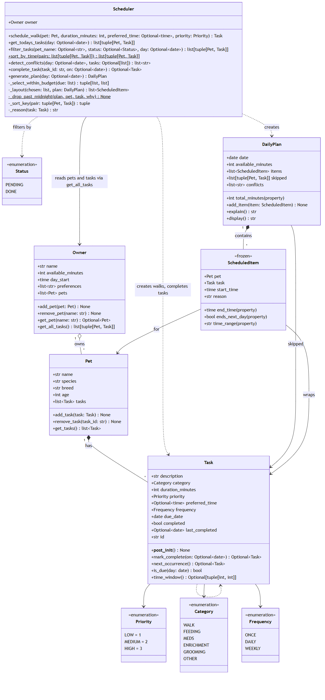

# PawPal+ (Module 2 Project)

You are building **PawPal+**, a Streamlit app that helps a pet owner plan care tasks for their pet.

## Scenario

A busy pet owner needs help staying consistent with pet care. They want an assistant that can:

- Track pet care tasks (walks, feeding, meds, enrichment, grooming, etc.)
- Consider constraints (time available, priority, owner preferences)
- Produce a daily plan and explain why it chose that plan

Your job is to design the system first (UML), then implement the logic in Python, then connect it to the Streamlit UI.

## What you will build

Your final app should:

- Let a user enter basic owner + pet info
- Let a user add/edit tasks (duration + priority at minimum)
- Generate a daily schedule/plan based on constraints and priorities
- Display the plan clearly (and ideally explain the reasoning)
- Include tests for the most important scheduling behaviors

## Getting started

### Setup

```bash
python -m venv .venv
source .venv/bin/activate  # Windows: .venv\Scripts\activate
pip install -r requirements.txt
```

### Suggested workflow

1. Read the scenario carefully and identify requirements and edge cases.
2. Draft a UML diagram (classes, attributes, methods, relationships).
3. Convert UML into Python class stubs (no logic yet).
4. Implement scheduling logic in small increments.
5. Add tests to verify key behaviors.
6. Connect your logic to the Streamlit UI in `app.py`.
7. Refine UML so it matches what you actually built.

## ✨ Features

- **Pets and tasks:** add as many pets as you like, each with its own care tasks (walks, feeding, meds, enrichment, grooming, other). Every task has a duration, a priority (low / medium / high), an optional preferred time and a repeat setting.
- **Sorting by time:** `Scheduler.sort_by_time()` lists tasks in clock order across all pets. Tasks with no set time go last, and higher priority wins ties.
- **Filtering:** `Scheduler.filter_tasks()` narrows the list by pet name and/or status (`pending` or `done`). The two filters can be combined.
- **Daily and weekly recurrence:** completing a daily or weekly task automatically creates the next one, due 1 or 7 days later (`Task.next_occurrence()`). One-off tasks just stay done.
- **Conflict warnings:** `Scheduler.detect_conflicts()` finds tasks whose time windows overlap, for one pet or between pets, and returns readable warnings instead of crashing.
- **Priority-first time budget:** `generate_plan()` picks the most important tasks first and keeps adding tasks until the owner's available minutes run out. Anything that doesn't fit is listed as skipped.
- **Conflict-free layout:** tasks with a set time go at that time, or right after the task before them if that slot is taken. Flexible tasks fill the earliest free gap from the start of the day. The final plan never double-books the owner.
- **Explained plans:** every scheduled task has a short reason, and `DailyPlan.explain()` lists the skipped tasks, overlaps and any moved times.
- **Midnight handling:** a task that runs past midnight is shown as `(+1 day)`. A task that can't start before midnight is skipped with a note.

## 🗺️ System Architecture

The final class diagram is in [`diagrams/uml_final.mmd`](diagrams/uml_final.mmd) (Mermaid source).



## 🧪 Testing PawPal+

Run the full test suite from the project root:

```bash
python -m pytest
```

The tests live in `tests/test_pawpal.py`. Every test that depends on a date passes one in explicitly, so the results don't change based on the day you run them. They cover:

- **Sorting:** tasks come back in time order across pets. Tasks at the same time are ordered by priority, then by the order they were added. Tasks with no set time go last. Empty lists work.
- **Recurring tasks:** completing a daily task creates a new copy due the next day, with a new id and the same time, priority and description. Weekly tasks repeat 7 days later. One-off tasks don't repeat. Completing a task twice doesn't create a duplicate. Copies can be completed again in a chain, including across Dec 31 → Jan 1. A task completed late gets its next due date from the day it was finished. Overdue tasks still count as due, and future tasks don't.
- **Conflict detection:** two tasks at the same time are flagged, for one pet or for two. Partial overlaps are flagged, and one long task overlapping several others gets a warning for each. Back-to-back tasks, finished tasks and tasks with no set time are not flagged.
- **Plan building:** no two scheduled items overlap. Tasks with no set time fill earlier free time. The time budget is respected, including a task that uses exactly the remaining minutes and a large task skipped so a smaller one still fits. Zero available minutes and an empty task list are handled. A task with a set time before the start of the day keeps that time.
- **Midnight:** a task that starts before midnight and ends after it stays on the plan and shows as `23:30-00:30 (+1 day)`. A task ending exactly at midnight shows no "(+1 day)". Tasks pushed past midnight, and tasks with no set time that don't fit before it, are skipped with a note.
- **Validation:** blank descriptions, zero or negative durations, duplicate pet names (ignoring case) and adding the same task twice are all rejected.

Output of a successful run:

```
============================= test session starts =============================
platform win32 -- Python 3.14.7, pytest-9.1.1, pluggy-1.6.0
rootdir: C:\Users\vikku\AI110\ai110-module2show-pawpal-starter
plugins: anyio-4.15.1
collected 31 items

tests\test_pawpal.py ...............................                     [100%]

============================= 31 passed in 0.13s ==============================
```

**Confidence Level: ★★★★☆ (4/5)**

All 31 tests pass and cover the main scheduling rules and their edge cases. Writing them turned up a real bug, where plans running past midnight showed times out of order, and that bug is now fixed. I'm not giving it 5 stars because:

- The Streamlit UI isn't tested automatically.
- Each day is planned on its own, so a task that runs past midnight isn't checked for conflicts against the next day's plan.
- A task skipped near midnight still uses up minutes from the day's time budget.

## 📐 Smarter Scheduling

All scheduling logic lives in `pawpal_system.py`.

| Feature | Method(s) | Notes |
|---------|-----------|-------|
| Task sorting | `Scheduler.sort_by_time()` | Clock order by preferred time; untimed tasks last; higher priority wins ties |
| Filtering | `Scheduler.filter_tasks()`, `Scheduler.get_todays_tasks()` | By pet name and/or status (`pending` / `done`); filters combine |
| Conflict handling | `Scheduler.detect_conflicts()` | Flags overlapping preferred times, for the same pet or different pets; returns warnings, never crashes |
| Recurring tasks | `Task.mark_complete()`, `Task.next_occurrence()`, `Scheduler.complete_task()` | Completing a daily/weekly task creates the next instance (+1 / +7 days) |
| Budget & layout | `Scheduler.generate_plan()`, `_select_within_budget()`, `_layout()` | Highest priority first until time runs out; flexible tasks fill gaps |

### Sorting: `Scheduler.sort_by_time()`

Returns `(pet, task)` pairs in clock order using Python's `sorted()` with a key function. The key is a tuple:
`(preferred_time or time.max, -priority)`. Tasks with no preferred time get `time.max`, so they sort to the end.
When two tasks share a time, the higher-priority one comes first. `preferred_time` is a `datetime.time`, so it
compares in clock order without any string parsing.

### Filtering: `Scheduler.filter_tasks(pet_name=None, status=None, day=None)`

- `pet_name` matches without regard to upper/lower case (`"mochi"` finds Mochi).
- `status` is `Status.PENDING` (due on `day` and not yet complete) or `Status.DONE` (marked complete).
  The plain strings `"pending"` / `"done"` also work. An unknown status raises a clear `ValueError`.
- Both filters can be combined, e.g. `filter_tasks(pet_name="Mochi", status="pending")`.
- `get_todays_tasks(day)` is shorthand for "pending tasks on this day". The planner uses it.

### Conflict detection: `Scheduler.detect_conflicts(day=None, tasks=None)`

A lightweight check that **returns warning strings instead of raising**, so the app always keeps running.

1. Take the due tasks that have a preferred time and turn each into a time window: `Task.time_window()` → `(start, end)` in minutes.
2. Sort the windows by start time.
3. Compare each window only with the tasks that start before it ends, then `break`. Tasks far apart in the day are never compared.

It catches exact same-time clashes (08:00 vs 08:00) and partial overlaps (08:00–08:30 vs 08:15). Each warning says whether the clash is
for one pet or two. `generate_plan()` also stores these warnings in `DailyPlan.conflicts`. It adds a note there whenever a timed task had to be pushed later.
The Streamlit app shows them as warning banners.

### Recurring tasks: `Task.mark_complete()` → `Task.next_occurrence()` → `Scheduler.complete_task()`

- Each `Task` has a `due_date` and a `frequency` (`once`, `daily`, `weekly`). `Task.is_due(day)` is simply
  "not completed and `due_date <= day`".
- `Task.mark_complete(on)` marks the task done and returns the next occurrence. That is a fresh copy with a new id,
  due `on + timedelta(days=1)` for daily tasks or `on + timedelta(days=7)` for weekly ones. One-off tasks return `None`.
  Completing an already-completed task also returns `None`, so duplicates can't be created.
- `Scheduler.complete_task(task_id)` finds the task across all pets, completes it, and adds the new instance to the same pet.
- Using `timedelta` means month ends, leap years, and year boundaries are handled correctly.

### Building the plan: `Scheduler.generate_plan()`

1. **Select** (`_select_within_budget`): sort by priority (high first), then preferred time, then shortest. Keep each task that still fits the
   owner's minutes, and list the rest as skipped. This greedy rule is predictable, so the most important care always gets in.
2. **Lay out** (`_layout`): timed tasks are placed at their preferred time, or as soon after as the previous task allows.
   This works even if the preferred time is before the owner's day start.
   Flexible tasks then fill the earliest free gap from the day start onward (`_earliest_gap`). They don't all get pushed to the end of the day.
   A timed task may end after midnight and is shown as `(+1 day)`. A task that would start after midnight, or a flexible task that doesn't fit before it, is skipped with a note.
3. **Explain** (`DailyPlan.explain()`): gives the reason for each task, lists skipped tasks, and lists conflicts.

## 📸 Demo Walkthrough

Start the app with `streamlit run app.py` (with the virtual environment activated).

### Main UI features

- **Owner:** set your name, how many minutes you have for pet care today, and when your day starts.
- **Add a Pet:** enter a name, species, breed and age. A blank or duplicate name shows an error instead of adding the pet.
- **Schedule a Task:** pick the pet, category, description, duration, priority, how often it repeats, and an optional preferred time. Choosing *Walk* with no description creates a walk through `Scheduler.schedule_walk()`.
- **Today's Tasks:** a list sorted by time that you can filter by pet and by status (pending, done or all). Each due task has a **Done** button; clicking it on a daily or weekly task creates the next one. A yellow warning box lists any overlapping tasks, and a green message confirms when there are none.
- **Build Schedule:** **Generate schedule** shows:
  - a green summary of how many tasks fit and how many minutes they use
  - a table of the plan with start and end times, pet, priority and the reason for each task
  - a blue note for any task that was moved later to avoid an overlap
  - a yellow warning and table for tasks skipped because time ran out
  - the full explanation in a collapsible section

### Example workflow

1. Set the owner to *Jordan* with 90 minutes, starting at 07:30.
2. Add two pets: **Biscuit** (dog) and **Mochi** (cat).
3. Schedule a 30-minute **walk** for Biscuit at 08:00 (category *Walk*, description left blank).
4. Add **Thyroid medication** for Mochi at 08:15, 5 minutes, high priority. A warning appears under *Today's Tasks*: the medication overlaps Biscuit's walk.
5. Add a **Litter box** task for Mochi with no preferred time.
6. Click **Generate schedule**. The litter box goes in the free slot at 07:30, the walk stays at 08:00, and the medication moves to 08:30 with a note saying why.
7. Click **Done** on the walk. It leaves today's pending list, and tomorrow's walk is created automatically.

### Scheduler behaviors shown

- **Sorting:** today's tasks and the plan appear in clock order, with untimed tasks last.
- **Filtering:** the pet and status filters above the task list.
- **Conflict warnings:** overlaps are shown before you build the plan, and moved tasks are explained after.
- **Recurrence:** marking a daily or weekly task done creates the next one.
- **Time budget:** low-priority tasks are skipped first when the minutes run out.

### Sample CLI output (`python main.py`)

`main.py` builds the same kind of household from code. It adds the tasks out of order on purpose, plus a few that clash, so every feature has something to show:

```
==================================================
All tasks, sorted by time
==================================================
  07:30  Breakfast for Biscuit [high, daily]
  08:00  Walk for Biscuit [high, daily]
  08:00  Flea treatment for Biscuit [medium, daily]
  08:15  Thyroid medication for Mochi [high, daily]
  18:00  Evening walk for Biscuit [medium, daily]
  18:00  Feather toy play for Mochi [medium, daily]
anytime  Litter box for Mochi [medium, daily]
anytime  Brush coat for Biscuit [low, weekly]

==================================================
Filter: Mochi's tasks only
==================================================
  08:15  Thyroid medication for Mochi [high, daily]
  18:00  Feather toy play for Mochi [medium, daily]
anytime  Litter box for Mochi [medium, daily]

==================================================
Recurring tasks: complete breakfast and brushing
==================================================
New Breakfast instance (daily) due:   2026-10-26  (today + 1 day)
New Brush coat instance (weekly) due: 2026-11-01  (today + 7 days)
Biscuit now has 7 task instances.
Done:
  07:30  Breakfast for Biscuit [high, daily]
anytime  Brush coat for Biscuit [low, weekly]
Due tomorrow:
  07:30  Breakfast for Biscuit [high, daily]
  08:00  Walk for Biscuit [high, daily]
  08:00  Flea treatment for Biscuit [medium, daily]
  08:15  Thyroid medication for Mochi [high, daily]
  18:00  Evening walk for Biscuit [medium, daily]
  18:00  Feather toy play for Mochi [medium, daily]
anytime  Litter box for Mochi [medium, daily]

==================================================
Conflict check
==================================================
! Flea treatment (08:00-08:05) overlaps Walk (08:00-08:30), both for Biscuit.
! Walk (08:00-08:30) overlaps Thyroid medication (08:15-08:20), Biscuit and Mochi.
! Evening walk (18:00-18:20) overlaps Feather toy play (18:00-18:20), Biscuit and Mochi.

==================================================
Today's Schedule for Jordan
==================================================
Plan for Sunday, Oct 25:
07:30-07:40  Litter box for Mochi (10 min) [medium]
08:00-08:30  Walk for Biscuit (30 min) [high]
08:30-08:35  Flea treatment for Biscuit (5 min) [medium]
08:35-08:40  Thyroid medication for Mochi (5 min) [high]
18:00-18:20  Evening walk for Biscuit (20 min) [medium]
18:20-18:40  Feather toy play for Mochi (20 min) [medium]

Why this plan:
Tasks were chosen by priority (high first), then preferred time, then shortest duration, until the 90 available minutes were used. Timed tasks were placed at their preferred times; flexible tasks fill the gaps.
Scheduled 6 task(s) using 90 minutes.
- Litter box (Mochi): medium priority, fits in the time budget (10 min)
- Walk (Biscuit): high priority, preferred around 08:00, fits in the time budget (30 min)
- Flea treatment (Biscuit): medium priority, preferred around 08:00, fits in the time budget (5 min), moved to 08:30 because the earlier slot was taken
- Thyroid medication (Mochi): high priority, preferred around 08:15, fits in the time budget (5 min), moved to 08:35 because the earlier slot was taken
- Evening walk (Biscuit): medium priority, preferred around 18:00, fits in the time budget (20 min)
- Feather toy play (Mochi): medium priority, preferred around 18:00, fits in the time budget (20 min), moved to 18:20 because the earlier slot was taken
Conflicts:
- Flea treatment (08:00-08:05) overlaps Walk (08:00-08:30), both for Biscuit.
- Walk (08:00-08:30) overlaps Thyroid medication (08:15-08:20), Biscuit and Mochi.
- Evening walk (18:00-18:20) overlaps Feather toy play (18:00-18:20), Biscuit and Mochi.
- Flea treatment for Biscuit wanted 08:00 but starts at 08:30.
- Thyroid medication for Mochi wanted 08:15 but starts at 08:35.
- Feather toy play for Mochi wanted 18:00 but starts at 18:20.
```
